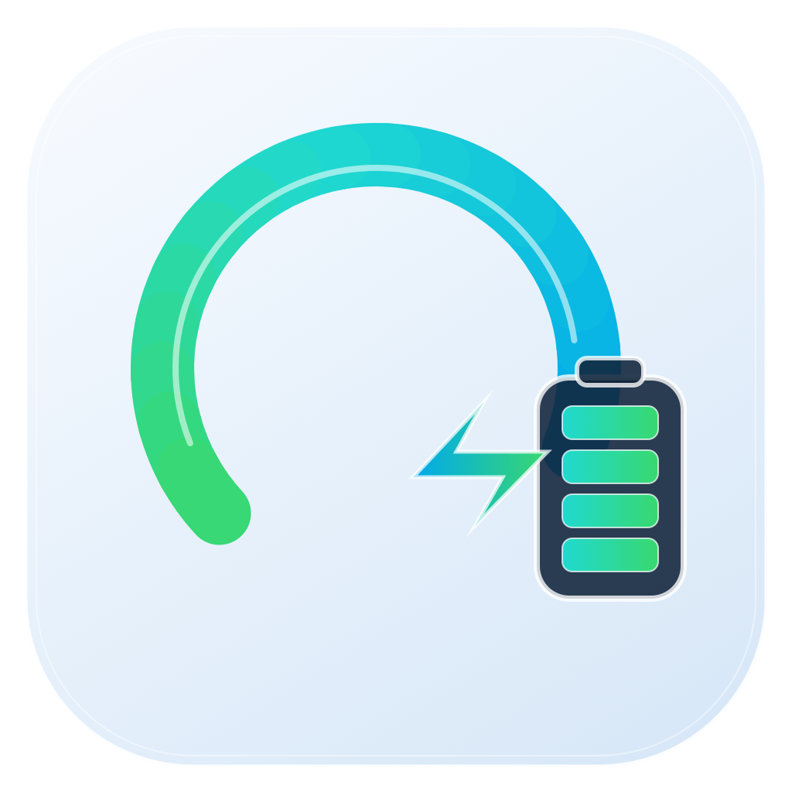
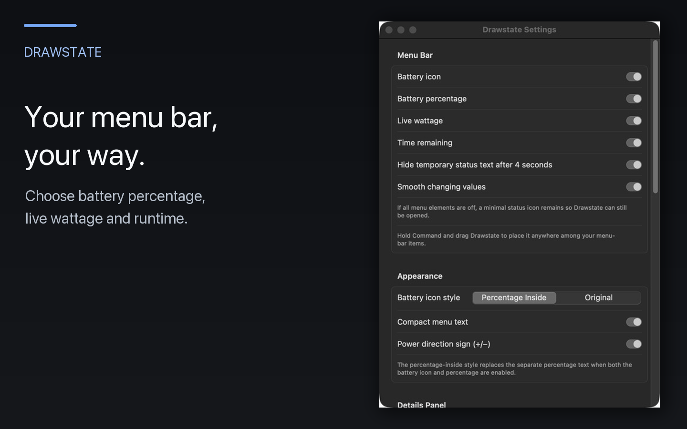

<p align="center">
  <picture>
    <source media="(prefers-color-scheme: dark)" srcset="docs/assets/README_Wordmark_Dark.svg">
    
  </picture>
</p>

<p align="center">Live power and battery telemetry in your Mac’s menu bar.</p>

<p align="center">
  <picture>
    <source media="(prefers-color-scheme: dark)" srcset="Resources/AppIconAppearances/AppIcon-Dark-1024.png">
    <source media="(prefers-color-scheme: light)" srcset="Resources/AppIconAppearances/AppIcon-Light-1024.png">
    
  </picture>
</p>

<p align="center">
<a href="https://github.com/Kian-hdr/Drawstate/releases/download/v1.0.5/Drawstate-1.0.5.dmg"></a>
</p>

<p align="center"><a href="https://github.com/Kian-hdr/Drawstate/releases/download/v1.0.5/Drawstate-1.0.5.dmg">DMG · v1.0.5 · macOS 14 or later</a></p>

<p align="center"><a href="#install">Install with Homebrew</a> · <a href="https://github.com/Kian-hdr/Drawstate/releases/tag/v1.0.5">Release notes</a></p>

<p align="center"></p>

Drawstate is a native, open-source macOS menu-bar utility for live power and battery telemetry. It shows how much power your Mac is receiving or consuming, battery percentage, power flow, and estimated time until full or empty.

Created and primarily developed by **Kian Konrad** and released under the [MIT License](LICENSE).

## Highlights

- Live signed wattage in the menu bar
- Battery percentage inside a level-aware battery icon
- Time until full or empty with smoothed fallback estimates
- Adapter input, Mac load, and battery charge or supply flow
- Battery health, voltage, current, cycles, and charger capability
- Conditional telemetry for compatible USB HID/UPS power banks, including remaining charge, output, and estimates
- Native Command-drag menu-bar positioning
- Native adaptive app icon with Default, Dark, and Monochrome appearances
- Integrated settings with individually configurable features
- Optional start at login through the standard macOS login-item service
- No account, cloud service, administrator access, analytics, or network connection

See [the complete feature guide](docs/FEATURES.md).

## Requirements

- macOS 14 Sonoma or later
- Apple Silicon or Intel Mac

Some measurements depend on what a particular Mac and charger expose. Missing readings appear as `—` rather than zero.

## Install

The downloadable edition is **Drawstate Direct**. It preserves every Drawstate feature, including the optional experimental charge-limit controls. A sandboxed **Mac App Store edition** is prepared separately and will be linked here only after it has passed App Review.

### Drawstate Direct from GitHub Releases

Download the latest notarized `Drawstate-VERSION.dmg` from [GitHub Releases](https://github.com/Kian-hdr/Drawstate/releases), open it, and drag `Drawstate.app` to Applications.

Public binaries are published only after Developer ID signing and Apple notarization. If the Releases page has no binary yet, build from source instead of downloading an unsigned copy from another source.

### Drawstate Direct with Homebrew

Use the official [Drawstate Homebrew tap](https://github.com/Kian-hdr/homebrew-drawstate):

```sh
brew tap Kian-hdr/drawstate
brew install --cask drawstate
```

Upgrade or uninstall with:

```sh
brew upgrade --cask drawstate
brew uninstall --cask drawstate
```

The Homebrew cask installs the same signed and notarized Drawstate Direct application as GitHub Releases.

### Build from source

Install Xcode, then run:

```sh
git clone https://github.com/Kian-hdr/Drawstate.git
cd Drawstate
swift test
./Scripts/package-app.sh release
open build/Drawstate.app
```

The local package script uses ad-hoc signing unless `DRAWSTATE_SIGNING_IDENTITY` is provided. Ad-hoc builds are for development and may require local Gatekeeper approval.

## Using Drawstate

Launch Drawstate and click its battery item in the menu bar. The overview panel shows live system, adapter, and battery flow. Open **Settings** inside the panel to choose exactly which icon, percentage, wattage, runtime, cards, and details appear.

Positive wattage means the Mac or battery is receiving adapter power. Negative wattage means the battery is supplying power. Readings are system telemetry estimates, not calibrated electrical-meter measurements.

### Compatible power banks

When a connected USB-C power bank publishes standard macOS UPS telemetry, Drawstate adds a compact **Power Bank** card near the bottom of the overview. It can show the reported device name, remaining percentage, charge state, voltage, current, output wattage, time until empty, and an estimated remaining percentage when the Mac reaches its charge target. Calculated values are labeled **Est.**

Most power banks expose power delivery but do not expose battery telemetry to macOS. Drawstate does not guess in that case: the existing interface remains unchanged, and no placeholder or menu-bar item appears. Compatible HID/UPS data and USB identity are read locally through public IOPowerSources and IOKit USB interfaces.

### Charge limits and editions

Drawstate Direct displays and can optionally change the system charge limit through an experimental on-device control under **Settings > Experimental**. It uses an undocumented macOS Smart Charge service, verifies every write, and may stop working after an OS update.

The Mac App Store edition is sandboxed and preserves Drawstate's read-only live wattage and power-flow telemetry, but contains no undocumented charge-limit writer, Swift bridge, or experimental control. Its compact Battery Settings card shows the current energy mode and provides **Open Battery Settings**. Its Settings view links to the Privacy Policy.

See [Drawstate editions](docs/EDITIONS.md) for the complete comparison.

## Privacy

All processing stays on the Mac. Drawstate does not collect or transmit data. Read the full [privacy statement](PRIVACY.md) and bundled privacy manifest.

## Set up with your AI agent

**[Copy the setup prompt into your agent's chat](SETUP-PROMPT.md).** No placeholders
need editing. Use an agent with access to your Mac; it will check compatibility,
download and verify the installer, preserve existing settings, and guide any
permissions or configuration you need to complete yourself.

The setup prompt checks the latest published release and Homebrew cask before
installation, and offers the documented source-build route when needed.

## Documentation

- [Features](docs/FEATURES.md)
- [Architecture](docs/ARCHITECTURE.md)
- [Building and releasing](docs/RELEASING.md)
- [Drawstate editions](docs/EDITIONS.md)
- [Mac App Store release procedure](docs/APP-STORE-RELEASE.md)
- [App Review notes](docs/APP-REVIEW-NOTES.md)
- [Mac App Store metadata](docs/APP-STORE-METADATA.md)
- [App icon design](docs/APP-ICON.md)
- [Contributing](CONTRIBUTING.md)
- [Support](SUPPORT.md)
- [Security policy](SECURITY.md)
- [Uninstall](UNINSTALL.md)
- [Changelog](CHANGELOG.md)
- [Acknowledgments](ACKNOWLEDGMENTS.md)

## Development

```sh
swift test
swift test -Xswiftc -DAPP_STORE
./Scripts/validate-editions.sh
codesign --verify --deep --strict --verbose=2 build/Drawstate.app
```

AI coding tools should read [AGENTS.md](AGENTS.md) before modifying the project. It documents the status-item lifecycle, telemetry semantics, preferences, installation paths, and required validation.

## Acknowledgments

**Leon Fischer-Appelt** provided the original idea that inspired the development of Drawstate. **Kian Konrad** is the creator and primary developer.

## License

Drawstate is available under the [MIT License](LICENSE).
